<!-- Header images and GIFs are intentionally hidden, not deleted. Remove these comment markers to display them again.

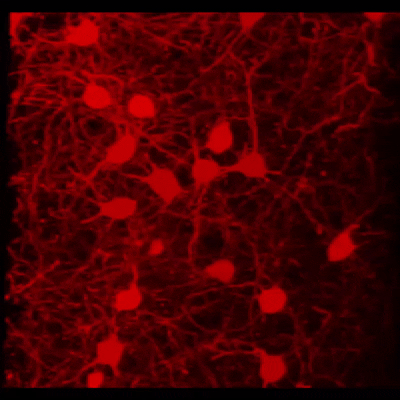

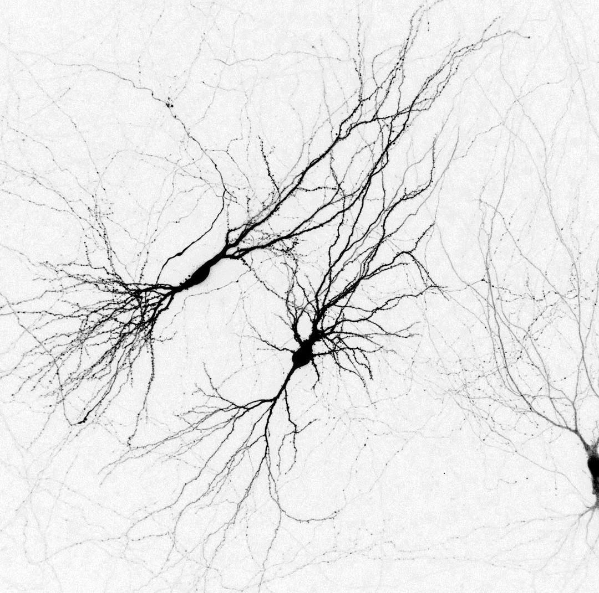
-->

# Alireza Hashemi

### Applied AI & Machine Learning Engineer

**Agentic AI · AI Agents & Orchestration · Deep Learning · LLM/RAG · Computer Vision**

---

## About

I'm an **Applied AI & Machine Learning Engineer** with **5+ years of experience** developing AI systems for industrial products and operational environments. My focus is on **agentic AI, LLM/RAG systems, deep learning, and production ML**, from modeling and evaluation to orchestration, tool integration, APIs, inference optimization, and deployment.

I enjoy building AI systems that work beyond a prototype: reliable, observable, maintainable, and grounded in real data. My work also spans **multimodal AI, computer vision, NLP, real-time video analytics, time-series modeling, medical imaging, and EEG/BCI research**.

---

## Experience & Expertise

- **Agentic AI & LLM engineering:** Specialized agents, orchestration, tool/function calling, model routing, memory, structured outputs, guardrails, and evaluation.
- **Retrieval, NLP & multimodal intelligence:** RAG/GraphRAG, hybrid retrieval, embeddings, reranking, NER/text classification, VLMs, OCR, and document understanding.
- **Applied ML & deep learning:** Data pipelines, training and fine-tuning, benchmarking, detection, segmentation, tracking, pose estimation, sequential modeling, and biomedical AI.
- **Production engineering:** Model serving, asynchronous processing, Docker-based deployment, CI/CD, CPU/GPU inference optimization, monitoring, and observability.

---

## Tools & Technologies

**Agentic AI, LLMs & Retrieval**  
         

**NLP & Text Processing**  
     

**Machine Learning & Deep Learning**  
         

**Computer Vision, Image & Signal Processing**  
              

**Backend, Data & AI Serving**  
         

**DevOps, Testing & Observability**  
        

---

## Research & Publications

1. **SpiTranNet-LIF: A Hybrid Spiking–Transformer Framework for Efficient Motor Imagery Decoding** · *Accepted for publication, ICCAR 2026.*
2. **Deep Learning for EEG-Based Motor Imagery Classification: A 2016–2026 Decade Review** · *Submitted manuscript.*
3. **Breast Cancer Classification using ResNeXt50_32x4d with Hybrid Loss** · *Submitted to Biomedical Signal Processing and Control; under review.*

[Google Scholar](https://scholar.google.com/citations?user=O7t8-3EAAAAJ&hl=en)

---

## GitHub Analytics

The cards below are generated from GitHub activity through a scheduled GitHub Actions workflow. SVGs are committed to this repository and refresh daily. Public repository language statistics reflect code composition, not proficiency; private work may not appear in repository-level breakdowns.

### Overview & Momentum

**GitHub Overview**  
A snapshot of overall contributions, merged pull requests, issues, stars, followers, and public repository activity.

<picture>
  <source media="(prefers-color-scheme: dark)" srcset="assets/profile-cards/overview.dark.svg" />
  
</picture>

**Contribution Momentum**  
A rolling 12-month view of contribution trends across account history.

<picture>
  <source media="(prefers-color-scheme: dark)" srcset="assets/profile-cards/momentum.dark.svg" />
  
</picture>

---

### Contributions & History

**3D Contribution Calendar & Streaks**  
A three-dimensional calendar of recent contributions, with current and longest streak statistics.

<picture>
  <source media="(prefers-color-scheme: dark)" srcset="assets/profile-cards/contributions.dark.svg" />
  
</picture>

**Lifetime Contribution History**  
Year-by-year contribution history showing how activity has evolved over time.

<picture>
  <source media="(prefers-color-scheme: dark)" srcset="assets/profile-cards/lifetime.dark.svg" />
  
</picture>

**Contribution Composition**  
Yearly breakdown of commits, pull requests, issues, reviews, and private contribution totals.

<picture>
  <source media="(prefers-color-scheme: dark)" srcset="assets/profile-cards/composition.dark.svg" />
  
</picture>

---

### Activity Patterns

**Contribution Rhythm**  
A view of contribution activity by weekday and month.

<picture>
  <source media="(prefers-color-scheme: dark)" srcset="assets/profile-cards/rhythm.dark.svg" />
  
</picture>

**Commit Cadence**  
A weekday-by-hour map of commits over the trailing year, plus time-of-day and commit-size patterns.

<picture>
  <source media="(prefers-color-scheme: dark)" srcset="assets/profile-cards/cadence.dark.svg" />
  
</picture>

---

### Repositories & Languages

**Repository Activity**  
A ranking of public repositories by recent commits, with language and repository context.

<picture>
  <source media="(prefers-color-scheme: dark)" srcset="assets/profile-cards/repositories.dark.svg" />
  
</picture>

**Repository Lifelines**  
Timelines showing the lifespan and development activity of publicly owned source repositories.

<picture>
  <source media="(prefers-color-scheme: dark)" srcset="assets/profile-cards/portfolio.dark.svg" />
  
</picture>

**Programming Languages**  
A treemap of language bytes across public source repositories, with a repository-frequency breakdown.

<picture>
  <source media="(prefers-color-scheme: dark)" srcset="assets/profile-cards/languages.dark.svg" />
  
</picture>

---

<!--[Explore GitHub's native contribution activity](https://github.com/alirzx)
-->

<!--
Legacy remote-generated statistics images have been intentionally hidden because the
public hosting endpoints can return HTTP 402, 503, or API fetch errors.
Kept for reference; the native GitHub activity view above is the reliable default.
https://github-profile-summary-cards.vercel.app/api/cards/profile-details?username=alirzx&theme=radical
https://github-readme-stats.vercel.app/api?username=alirzx&show_icons=true&theme=tokyonight&hide_border=true&include_all_commits=true&count_private=true
https://github-readme-stats.vercel.app/api/top-langs/?username=alirzx&layout=compact&theme=tokyonight&hide_border=true
https://github-readme-streak-stats.herokuapp.com?user=alirzx&theme=tokyonight&hide_border=true
https://github-profile-trophy.vercel.app/?username=alirzx&theme=tokyonight&no-frame=true&no-bg=true&column=7
https://github-readme-activity-graph.vercel.app/graph?username=alirzx&theme=tokyo-night&hide_border=true
-->
